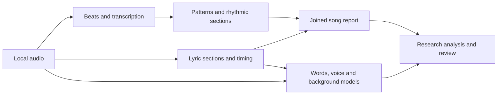

# MIDI recommendation research

This project analyzes music recordings to describe rhythmic patterns and their relationship to lyric sections. It also studies model-rated words, voice, and background audio in a 325-song development sample. These are research outputs, not verified measures of a listener's emotions.

See [Reproduction and methodology](REPRODUCIBILITY.md) for setup, commands, data requirements, pipeline logic, and the limits of the results. The local review application is described in [frontend/README.md](frontend/README.md).
